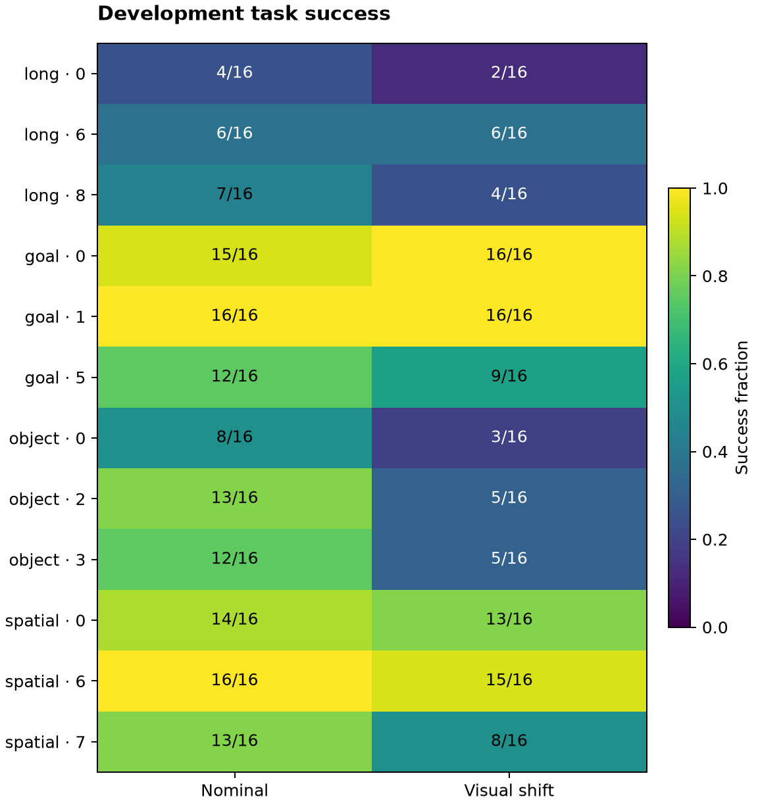
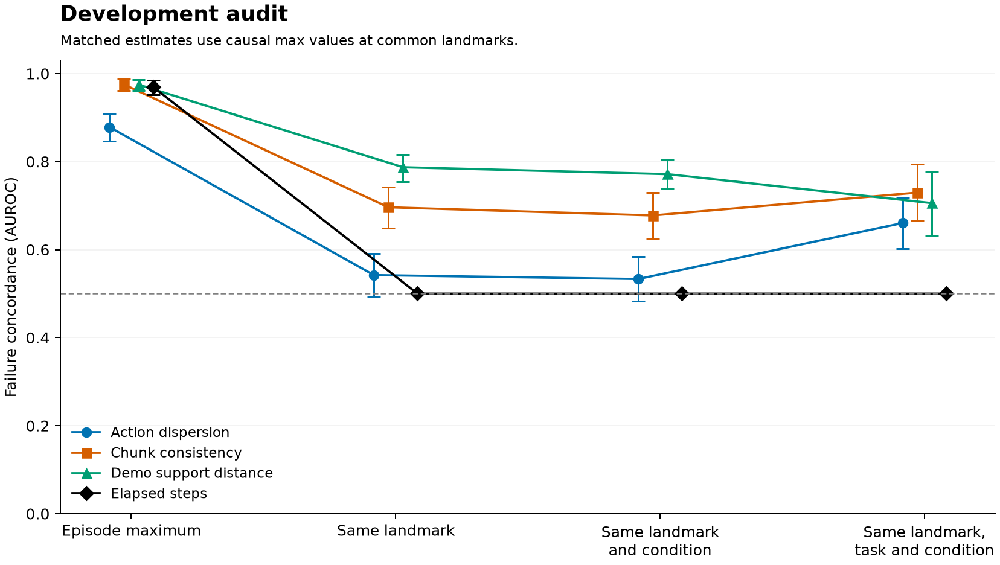

# Development report — 2026-11-11

> Historical development record. The subsequently completed, separately collected core study is in [FINAL_REPORT.md](FINAL_REPORT.md). These development cohorts are not pooled with its held-out estimates.

**Development data only. H1–H4 are not confirmed; no held-out robotics outcomes have been run.**

**Reset-audit update:** the H4 pilot exposed native LIBERO reset history changing a static stove
position outside the saved physics vector. This historical run reused native cores, so paired
nominal/shift episodes need not share every fixture pose. The success-rate difference below is
descriptive; it does not isolate the visual shift. Future runs use isolated episode resets and
require a new development calibration before freeze. See [H4_PROTOCOL.md](H4_PROTOCOL.md).
The completed 228-branch development intervention pilot is reported separately in
[H4_DEV_REPORT.md](H4_DEV_REPORT.md).

The audit changes the apparent performance substantially. Elapsed steps alone have naive AUROC
0.969 but exactly 0.500 under time matching. The simple action and support signals retain predictive
information in the primary conditional comparison on these dev tasks. This motivates held-out
verification; it does not establish a general property of VLA monitors.

## Data and execution

- 384 episodes: 12 dev tasks × 2 conditions × 16 paired initial states/policy seeds. All four suites
  contribute three dev tasks. The underlying policy was trained on the 40-task benchmark; the task
  split holds out monitor tuning outcomes, not policy training tasks.
- Nominal success: **136/192 (70.8%)**. Visual shift success: **102/192 (53.1%)**. Overall failure:
  **146/384 (38.0%)**. Brightness 0.6 and noise σ=10 reach the historical development calibration
  target; that calibration must be repeated under isolated resets.
- Native Apple M5 MPS execution, standard always-render observations, K=1 reference execution every
  50 actions, and K=8 independent monitor samples every 25 steps. CPU and MPS data are not pooled.
- Full rollouts took 3,545 episode-wall seconds (59.1 minutes); the average monitor query took
  0.436 s. The run is complete and a checksum-verified archived resume skipped all 384 episodes.
- The final training-source bank has 600 frames from 60 demos, 50 vectors per dev task. A fresh
  extraction reproduced all vectors bit-for-bit across processes. Its immutable dataset revision is
  recorded; the checkpoint's historical training dataset revision is unknown.

Shift impact is heterogeneous: the object-suite success count drops from 33/48 to 13/48, while
its goal-suite counterpart changes from 43/48 to 41/48. The long tasks are difficult in both
conditions (17/48 and 12/48). A pooled shift rate does not mean equal task difficulty.

## Audit: causal running maxima

Naive scores are maxima over full episodes. Matched scores are causal prefix maxima at common
landmarks with all signals available. All intervals resample whole paired episodes within each task
(1,000 draws). Matching changes the compared pairs and risk sets; differences are descriptive,
not a causal decomposition of how much information each confound contributed.

| Signal | Naive | Time | Time + condition | Time + task + condition |
|---|---|---|---|---|
| elapsed | 0.969 [0.951, 0.984] | 0.500 [0.500, 0.500] | 0.500 [0.500, 0.500] | 0.500 [0.500, 0.500] |
| dispersion | 0.878 [0.846, 0.909] | 0.542 [0.492, 0.592] | 0.533 [0.483, 0.584] | 0.660 [0.602, 0.718] |
| consistency | 0.975 [0.961, 0.988] | 0.696 [0.649, 0.743] | 0.678 [0.625, 0.729] | 0.730 [0.665, 0.794] |
| support | 0.975 [0.961, 0.986] | 0.787 [0.755, 0.817] | 0.771 [0.738, 0.804] | 0.706 [0.632, 0.777] |

The primary comparison contains **3,370 landmark rows, 6,265 failure/success pairs, and 155 informative
strata out of 290**. Strata without both outcomes contribute no pairs and are counted; their score
is not filled with 0.5. The bootstrap had no degenerate draws. Intervals are conditional on these
tasks and observed episodes, not generalization intervals over arbitrary robot tasks.

**Development candidate for H1:** consistency with a running maximum has the largest primary point
estimate, 0.730 [0.665, 0.794]. The nine signal/reduction candidates were inspected on dev data;
this is selection evidence rather than a confirmatory H1 test. Other intervals overlap, and no
paired comparison establishes that this candidate is better than the others.

Matching does not always lower a score: dispersion improves from time-only to full matching.
Task mixture can hide within-task associations as well as inflate apparent performance.
All max/mean/last estimates are retained in the analysis artifact; the last-value plot is provided
as a separate view, not substituted for an unfavorable result.

## H3: conditional support association is history-dependent

The prototype fits a pairwise conditional logistic composite likelihood within task/condition/time
strata, controlling for dispersion and consistency. Coefficients below are per observed feature SD.
Intervals use the basic paired-cluster bootstrap after synthetic calibration identified undercoverage
with percentile intervals. See [VALIDATION.md](VALIDATION.md) for that correction and fresh simulation results.

| History reduction | Support coefficient | 95% basic-bootstrap interval |
|---|---:|---|
| last | 1.069 | [0.552, 1.462] |
| max | 0.883 | [-0.016, 1.480] |
| mean | 1.028 | [-0.068, 1.766] |

Every fit used 6,265 pairs and retained all 1,000 bootstrap draws. Last-value consistency also has a
positive conditional coefficient (1.244 [0.861, 1.501]); last-value dispersion does not
(0.035 [−0.156, 0.212]). Support's positive last-value association is not robust evidence of a
reduction-independent effect: the max/mean intervals include zero. The model describes conditional
association with two measured uncertainty proxies, not a causal mechanism or complete policy knowledge.

## Counterfactual engine and remaining work

Known-answer prefix replay reproduced future actions, physics states, observation embeddings and
outcomes exactly at **15 eligible development checkpoints** across four suites and two conditions.
Eight checks use step 50; seven use step 100. One step-100 case is skipped because the episode has
already ended. Oracle rollback and replan-in-place receive equal remaining forward-action budgets.
This validates the engine, not H4: alarm thresholds, matched state sampling, branch seeds and the
intervention-value interpretation still need a frozen protocol. Oracle rollback is a simulation-only
operation and its replay compute time is not a physical recovery cost.

Before any held-out run: finalize the H1 selection and H3 feature/test rules, finish the H4 alarm
protocol, freeze multiplicity and confidence procedures, locally commit preregistration, and retain
the frozen execution environment. Literature positioning is replication/audit; see LITERATURE.md.

## Artifact index

- Rollouts: `artifacts/dev_rollouts/135f2c14e328/`
- Final bank: `artifacts/demo_bank/f5972cdb4670/`
- Audit/scored landmarks: `artifacts/dev_analysis/903581b133ed/`
- H3 last / max / mean: `artifacts/h3_dev/cf4e54e15cb7/`, `8a04d9c2144f/`, `cf5bdabbdc7b/`
- Replay gates: `artifacts/branch_validation/a86bbc1ede86/` and `c856be42b41d/`
- Synthetic interval checks and scope: `VALIDATION.md`

Raw arrays, exact source archives, and input videos remain local under the existing artifact policy.
Manifests/results and the report figures are reviewable repository artifacts. No confirmatory
robotics report or outreach claim should present these development findings as held-out evidence.
