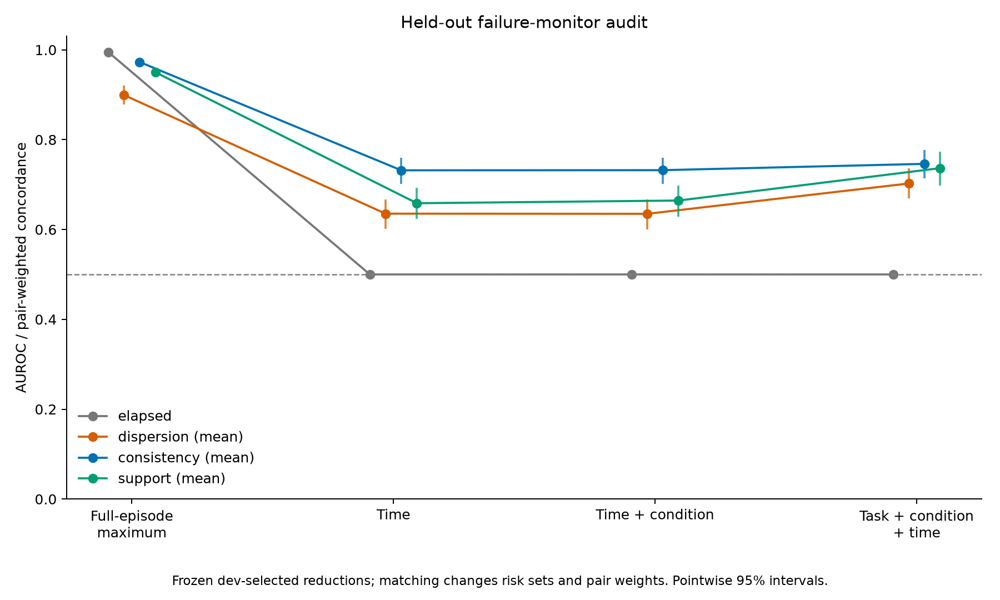
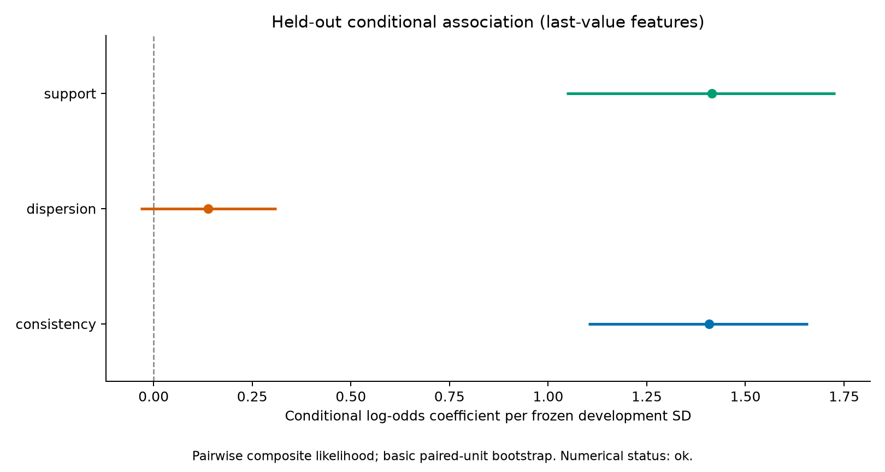
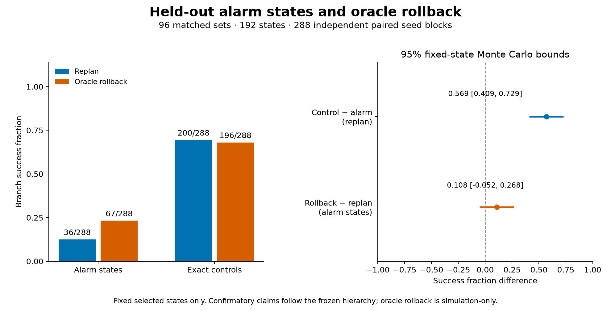

# RoboMon core-study report — 2026-11-12

The core H1–H4 study is complete. H2 is descriptive; the optional H5 stretch was excluded before testing.

The frozen sequence supports H1, H3, H4a. The frozen signal retains predictive association after matching. Training-source support adds positive conditional association within the declared working model. Fresh-replan branch success is 12.5% at alarm states versus 69.4% at controls. Alarm rollback branch success is 23.3%; its success-fraction difference bound is 0.108 [-0.052, 0.268]. A positive recovery benefit is not established by the frozen test.

**Frozen before test outcomes:** `5aca84453a411d9c3b8bc824415a0b95d79edd15`. The committed protocol and methods are in [frozen_protocol.json](frozen_protocol.json) and [CONFIRMATORY_METHODS.md](CONFIRMATORY_METHODS.md).

## Prespecified results

| Hypothesis | Estimate and two-sided 95% interval/bound | Fixed-sequence decision |
|---|---|---|
| H1 | 0.746 [0.713, 0.777] | supported |
| H3 | 1.415 [1.046, 1.728] | supported |
| H4a | 0.569 [0.409, 0.729] | supported |
| H4b | 0.108 [-0.052, 0.268] | not established |

The confirmatory sequence is H1 → H3 → H4a → H4b. After its first failure or inconclusive result, later intervals are descriptive only. Bootstrap coverage and nominal family-wise control are approximate; H4 bounds cover only branch-noise Monte Carlo error conditional on selected states.

## Held-out prediction audit

Collected **896 episodes**: 28 monitor-test tasks × 2 conditions × 16 initial-state/policy-seed pairs. All **448 paired initial physics/static scenes** agree exactly. SmolVLA was trained on these task identities; holdout refers to monitor tuning.

The frozen H1 choice is **consistency / mean**, selected solely by the maximum development primary point estimate. Its primary concordance is **0.746 [0.713, 0.777]**, using 13,208 comparable pairs and 333 informative strata of 735.

Naive scores use full-episode maxima; matched scores use the frozen causal reduction chosen for each signal on development data. Matching changes risk sets and pair weights, so differences are descriptive rather than a causal decomposition. All signals/reductions and strata/degenerate-draw counts remain in the analysis artifact.

| Signal (frozen causal reduction) | Naive episode max | Time | Time + condition | Task + condition + time |
|---|---:|---:|---:|---:|
| elapsed | 0.995 [0.991, 0.998] | 0.500 [0.500, 0.500] | 0.500 [0.500, 0.500] | 0.500 [0.500, 0.500] |
| dispersion / mean | 0.899 [0.878, 0.920] | 0.635 [0.601, 0.667] | 0.635 [0.600, 0.666] | 0.702 [0.669, 0.736] |
| consistency / mean | 0.973 [0.962, 0.983] | 0.732 [0.701, 0.760] | 0.732 [0.702, 0.760] | 0.746 [0.713, 0.777] |
| support / mean | 0.950 [0.940, 0.959] | 0.659 [0.623, 0.693] | 0.664 [0.628, 0.698] | 0.737 [0.697, 0.773] |

| Condition | Successes / episodes | Success fraction |
|---|---:|---:|
| nominal | 307/448 | 68.5% |
| shift | 301/448 | 67.2% |

Visual shift: brightness 0.6, Gaussian pixel-noise σ=10.0 on the 0–255 scale. Its strength was frozen from isolated-reset development calibration, not adjusted to held-out success.

The 50–60% calibration target applied to development; the held-out task mix was collected at exactly that frozen shift strength. No held-out retuning or outcome-based replacement occurred.

## Conditional training-source support association

| Last-value feature | Coefficient per frozen dev SD [95% basic-bootstrap interval] |
|---|---|
| support | 1.415 [1.046, 1.728] |
| dispersion | 0.139 [-0.033, 0.311] |
| consistency | 1.408 [1.101, 1.659] |

Numerical status: **ok**; 2,000 / 2,000 valid bootstrap fits. H1 has 2,000 / 2,000 valid draws. This is a pairwise conditional logistic composite likelihood, controlling task/condition/time and two measured linear uncertainty proxies. A support coefficient is an association within this working model, not proof of causal training-data knowledge or complete model uncertainty. The bank measures distance to a pinned version of the named training source; exact historical training bytes are unknown.

## Frozen selected-state interventions

Outcome-blind matching selected **96 sets / 192 states** from 55/56 task/condition cells. All **192 known-answer gates** passed before 1,152 intervention branches. Missing alarms/controls are reported without replacement. Three seed blocks per matched set pair both states and both arms; arms receive equal remaining forward-action budgets.

| State / arm | Success fraction |
|---|---:|
| alarm replan | 12.5% |
| alarm rollback | 23.3% |
| control replan | 69.4% |
| control rollback | 68.1% |

| Contrast | Estimate [95% fixed-state MC bound] | Positive / zero / negative seed-block differences |
|---|---|---:|
| control rollback minus replan exploratory | -0.014 [-0.174, 0.146] | 15 / 254 / 19 |
| h4a control minus alarm replan | 0.569 [0.409, 0.729] | 170 / 112 / 6 |
| h4b alarm rollback minus replan | 0.108 [-0.052, 0.268] | 38 / 243 / 7 |

H4a compares fresh-replan success at exact controls versus alarm states. H4b compares oracle rollback versus fresh replanning at alarm states. Bounds are conservative Hoeffding intervals on independent paired seed-block differences; they do not cover state selection or new-task transfer. A wide bound is inconclusive rather than evidence of no effect. Oracle reset/replay is simulation-only and does not measure physical recovery costs.

## Development history, scope and reproducibility

The historical native-reset audit exposed a LIBERO sampler-history bug. It changed static fixture positions outside qpos/qvel. The failed partial pilot was preserved and excluded; [RESET_AUDIT.md](RESET_AUDIT.md) provides a minimal independent repro. The full replacement development calibration and held-out study use isolated cores, exact paired-scene checks, and fresh cores for every intervention branch. Historical and replacement cohorts are not pooled.

This is an independent audit/replication using simple inspired baselines, not a new detector or a reproduction of every published method. [LITERATURE.md](LITERATURE.md) records the checked positioning. Results concern the declared tasks, initial states, checkpoint, visual condition and native MPS stack, not arbitrary robot tasks or real-robot safety.

Primary artifact: `artifacts/test_analysis/af5b72fce0bb`. Intervention artifact: `artifacts/h4_analysis_test/fcc34b1175a6`. Selection: `artifacts/h4_selection_test/710295bc600c`. Model/tokenizer, simulator/controller, assets, BDDL and initial-state hashes are frozen in the protocol. Exact source archives, atomic transactions and checked resume preserve launch-time code; raw arrays/archives stay local under repository policy. Figures have input/source/PNG provenance.
