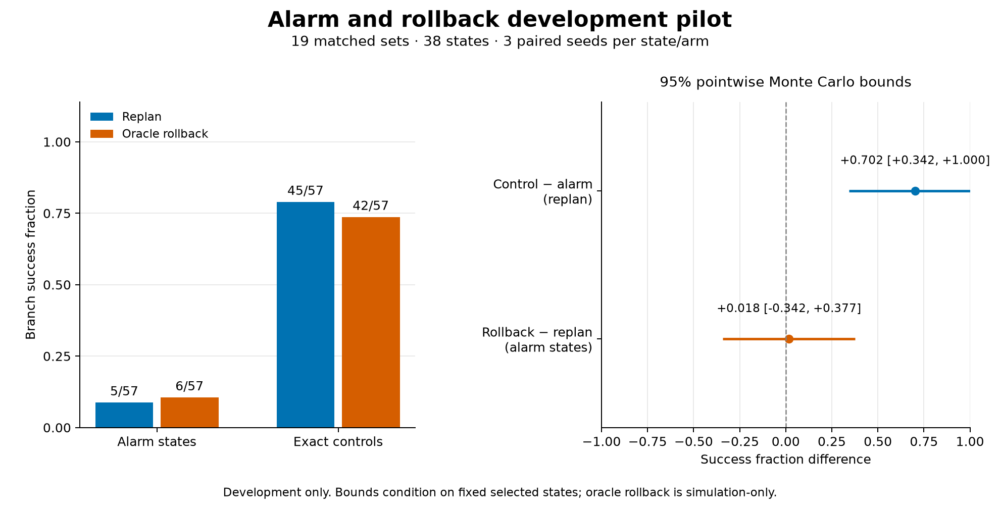

# Alarm and rollback development pilot — 2026-11-11

> Historical development record. The subsequently completed, separately collected core study is in [FINAL_REPORT.md](FINAL_REPORT.md). These development cohorts are not pooled with its held-out estimates.

**Development only. No held-out robotics outcomes have been opened, and H4 is not confirmed.**

At these selected states, the alarm identifies situations that are much harder for a fresh replan:
5/57 alarm-state branches succeed, versus 45/57 exact-control branches. A one-chunk oracle rollback
changes alarm-state successes from 5 to 6. Its uncertainty is wide, so this pilot does not establish
a useful recovery benefit or demonstrate that rollback has no effect.

## Cohort and protocol

- Historical development inputs: 384 episodes, 12 tasks, nominal and shifted observations.
  The native reset qualification in [RESET_AUDIT.md](RESET_AUDIT.md) applies to these inputs.
- Alarm: causal running-max consistency, including shadow queries. The threshold
  **0.9963464299006517** is the 75th percentile (`higher`) of one eligible maximum per nominal
  episode, irrespective of terminal outcome. This is not a conformal or false-alarm guarantee.
- At each episode's first eligible crossing, require an alive, below-threshold control at the
  **same task, condition and timestep**. Boundaries are multiples of 50, with >=50 forward actions
  left. Hash-ordered greedy matching selects one pair per cell, without reusing source pair IDs.
  No terminal success/failure labels enter calibration or matching.
- **19 matched sets / 38 states**, covering 19/24 cells and 10/12 development tasks. Four cells have
  no alarms: goal 0 shifted, goal 1 nominal/shifted, and spatial 6 nominal. Spatial 6 shifted has an
  alarm but no exact control. There are no substituted cells.
- **Three fresh seed blocks per matched set**, common across both states and both arms. Both
  replan and 50-action rollback receive `original_horizon - checkpoint` forward actions. Oracle
  rollback is simulation-only; reset/replay compute is not a physical recovery cost.

The initial protocol preceded the first pilot. That run stopped at its ninth gate because reset
history changed a stove pose outside the stored physics vector. It is retained as a failed partial
run, not pooled into this result. The reset-context repair is documented in RESET_AUDIT.md.
Threshold, selected pairs and coverage remained **byte-identical** after the repair; no state was
replaced because of an outcome or replay failure. Launch-time protocol text is stored in each
manifest; [H4_PROTOCOL.md](H4_PROTOCOL.md) also records the amendment and its timing.

All **38 original-tail replay gates passed before any intervention arms opened** in the replacement
run. Every gate matches future actions, physics states, first embedding and outcome exactly.
The full pilot completed **228 intervention branches** plus those 38 gates. The sum of recorded
gate/branch wall times is 50.1 minutes, including reset-history reconstruction. Archived resume
checksum-verified and skipped all 266 records without loading weights.

## Results

| Selected state / arm | Successes | Success fraction |
|---|---:|---:|
| Alarm, fresh replan | 5/57 | 8.8% |
| Alarm, oracle rollback | 6/57 | 10.5% |
| Exact control, fresh replan | 45/57 | 78.9% |
| Exact control, oracle rollback | 42/57 | 73.7% |

Each contrast uses **57 independent paired seed blocks**, not 228 independent arms. Bounds are
two-sided 95% **pointwise Hoeffding Monte Carlo bounds**, conditional on the fixed selected states.
The unclipped radius is 0.35977; bounds are clipped to the natural [-1, 1] range. The formula and
assumptions are in H4_PROTOCOL.md. They do not cover development selection or new-state/task
generalization, and no multiplicity-adjusted confirmatory decision is made here.

| Contrast in success fraction | Estimate | 95% fixed-state MC bound | Positive / tied / negative draws |
|---|---:|---|---:|
| Control minus alarm, fresh replan | +0.702 | [+0.342, +1.000] | 41 / 15 / 1 |
| Alarm rollback minus replan | +0.018 | [-0.342, +0.377] | 3 / 52 / 2 |
| Control rollback minus replan (exploratory) | -0.053 | [-0.412, +0.307] | 5 / 44 / 8 |

The risk difference is large in this finite selected cohort, even under the conservative noise
bound. Matching task/condition/time does not equalize every feature of a physical state, and this
association does not establish what the monitor knows or guarantee performance at new states.

Rollback improves three paired alarm draws and worsens two; 52 tie. The net one-success increase
does not establish practical usefulness. More branch seeds would reduce Monte Carlo uncertainty
but would not by themselves validate transfer to new states or quantify physical recovery cost.

## Validation and next stage

Analysis verified every completion checksum, branch identity, complete arm/replicate grid, common
and distinct block seeds, equal action budgets, finite arrays, trace lengths and advancing simulator
time. **51 fast tests** pass, as does the new real-simulator reset regression. The figure was visually
checked and has a sidecar recording input, plotting-source and PNG hashes.

Future rollouts default to isolated episode cores and save actual reset context, static model poses
and initial physics. Eight smoke rollouts verify four paired static scenes; full development
calibration under this final regime remains required. The historical audit and this legacy-state
pilot must not be pooled with that replacement. Reassess development choices, freeze the statistical
and intervention protocol, and locally commit it before any held-out run.

## Artifacts

- Selection: `artifacts/h4_selection_dev/1265d2098d6d/`
- Complete raw pilot and archived source: `artifacts/h4_dev/e1139cfc2fc7/`
- Verified analysis: `artifacts/h4_analysis_dev/05bb3327bc8c/`
- Failed initial pilot: `artifacts/h4_dev/acce37642d03/` (excluded)
- Figure and provenance: `figures/dev_h4_pilot.png`, `figures/dev_h4_pilot.provenance.json`
- Reset diagnostics, isolated smoke and commands: RESET_AUDIT.md

Manifests, result summaries and the figure are reviewable repository artifacts. Raw arrays and
source archives remain local under the repository's artifact policy.
