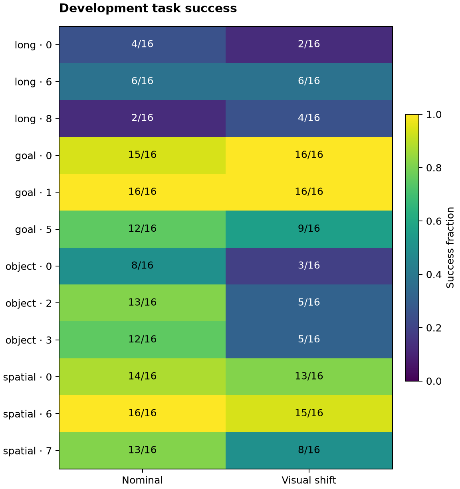
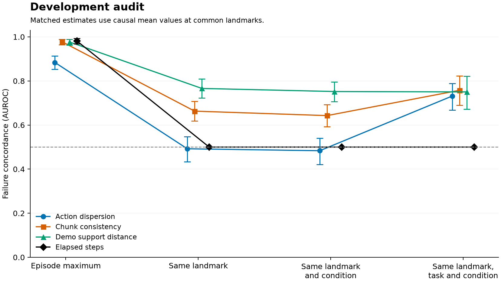

# Isolated-reset development calibration — 2026-11-11

This replacement cohort supplies the pre-test development choices. Historical native-reset results
remain in [DEV_REPORT.md](DEV_REPORT.md) and [H4_DEV_REPORT.md](H4_DEV_REPORT.md); they are not pooled
with this calibration. No held-out outcomes were used here.

All **384 episodes** completed: 12 development tasks × two conditions × 16 paired initial states /
policy seeds. Archived resume verified and skipped all 384 outputs without loading weights.
All **192 nominal/shift initial physics, body-position and body-quaternion pairs agree exactly**.
The fresh real-simulator regression also reproduces isolated reset/replay observations exactly.

| Condition | Successes | Fraction |
|---|---:|---:|
| Nominal | 131/192 | 68.2% |
| Brightness 0.6, pixel-noise σ=10 | 102/192 | 53.1% |

The shifted rate passes the 50–60% calibration gate. Overall failure is 39.3%, passing 20–80%.
All planned task/condition cells and primary comparisons are present. Episode wall time totals
65.6 minutes on the native M5 MPS stack. Reset isolation changes physical inputs relative to native
history; legacy and replacement success rates must not be treated as repeated trials of one regime.

## Signal selection

The prospective rule takes the largest primary point estimate among three signals × three causal
reductions, with a lexical signal/reduction tie break. It selects **consistency / mean**. Every
signal's individually selected descriptive reduction is also mean. This is a development selection,
not an established superiority claim. The intervals overlap.

| Causal mean signal | Primary concordance [95% interval] |
|---|---:|
| Consistency | 0.758 [0.690, 0.824] |
| Support distance | 0.750 [0.673, 0.821] |
| Dispersion | 0.732 [0.667, 0.789] |
| Elapsed | 0.500 [0.500, 0.500] |

There are 5,797 comparable pairs and 153 informative strata out of 290. Intervals use 1,000
within-task paired-unit bootstrap draws; all draws are valid. The resampling universe retains
original pairs with zero common landmarks. Matching changes comparison populations and weights;
changes across matching levels are descriptive, not a causal decomposition.

## Conditional association and alarm calibration

The prespecified H3 choice remains last-value support, dispersion and consistency, with basic
paired-unit bootstrap intervals. Support's development coefficient is 1.198 [0.492, 1.611] per
feature SD, with all 2,000 draws valid. Development sensitivity: max support is 1.070 [0.013, 1.717]
and mean support 1.285 [−0.172, 2.124], each using 1,000 draws. These are development diagnostics;
the last-value H3 choice was declared before this replacement cohort completed.

For H4, mean-consistency's nominal-development episode-max 75th percentile (`higher`) is
**0.45370636311812385**. Outcome-blind exact matching at a cap of one set per development
task/condition selects **21 sets / 42 states**. Controls may not have crossed this threshold at
any earlier eligible boundary. The held-out cap is prospectively fixed at two sets per cell,
with three paired seed blocks per set and no source pair reuse across conditions.

## Provenance

- Rollouts: `artifacts/dev_rollouts/e93d773ba5f3/`
- Paired scene verification: `artifacts/reset_validation/2effe8e037de/`
- Development bank: `artifacts/demo_bank/f5972cdb4670/` (600 frames, 60 demos, 12 tasks)
- Analysis: `artifacts/dev_analysis/8b2bc61f4df7/`
- H3 last / max / mean: `185d70231b96`, `f9e5c1d80c10`, `9c1786f143bd`
- H4 selection: `artifacts/h4_selection_dev/5ed3daa419de/`
- Replay gates: `artifacts/h4_dev/3c47effc957a/` (**all 42 passed exactly**, archived resume verified)
- Figure hashes: `figures/isolated_dev_provenance.json`

The full prospective rules and limitations are in [CONFIRMATORY_METHODS.md](CONFIRMATORY_METHODS.md).
The separate local protocol commit and post-commit receipt must precede every held-out entry point.
