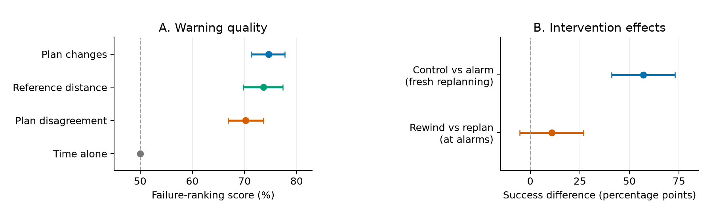

# RoboMon — Robot Failure Monitoring

## Question

Can simple warning scores predict robot failure beyond knowing the task and how long the robot has been trying? Can acting on those warnings help it recover?

## What I built

I built an evaluation pipeline around SmolVLA, an existing robot-control model, and LIBERO, a simulated robot benchmark. It records robot behavior and measures four signals: elapsed time, disagreement among possible movement plans, changes in plans over time, and distance from reference demonstrations.

## How I tested it

- Used **384 development attempts** to choose settings, then fixed the study rules before **896 evaluation attempts** on 28 separate tasks with normal and degraded camera images.
- Compared ongoing attempts at the **same task, camera condition, and timestep** to separate warning information from task difficulty and elapsed time.
- Ran **1,152 alternative continuations** from 192 selected alarm/control states, comparing fresh replanning with rewinding 50 actions. Both strategies received the same remaining action budget.
- Found a simulator reset bug that changed fixture positions. I corrected the reset procedure and verified exact replay for all 192 selected states before testing interventions.

## Main findings

- **Useful warnings:** The average plan-change score ranked failed attempts above successful ones in **74.6% of matched comparisons** (95% interval: 71.3%–77.7%).
- **Reference similarity added information:** Distance from demonstrations remained associated with failure after accounting for both plan-disagreement signals in the statistical model.
- **Alarms identified difficult states:** Fresh replanning succeeded in **12.5%** of alarm-state continuations versus **69.4%** at matched controls.
- **Recovery remains unresolved:** Rewinding raised observed alarm-state success to **23.3%**, but the uncertainty was too large to establish a reliable improvement.

Left: warning quality after matching; 50% is chance. Right: differences in success rates; crossing zero leaves the benefit uncertain. Bars show 95% intervals; recovery bounds apply only to the selected states.

## Limits

This is an independent study of one pretrained model in simulation. Evaluation tasks were held out from monitor tuning but were familiar to the policy. Recovery results concern the selected states; physical-robot recovery and safety were not tested.

[Full report and figures](FINAL_REPORT.md) · [Study methods](CONFIRMATORY_METHODS.md)
